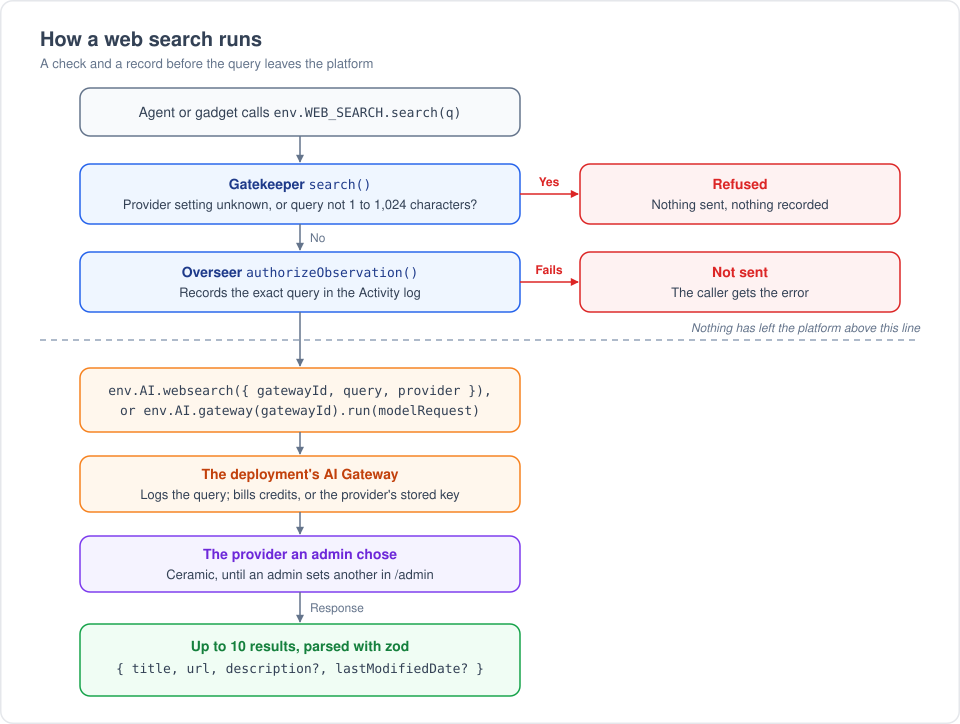
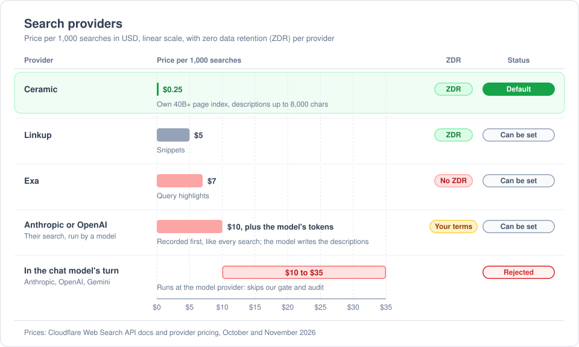

# Web Search

Web Search is an ambient gatekeeper that lets the agent and gadgets search the public web through
the deployment's AI Gateway. By default a search runs on Cloudflare's
[Web Search API](https://developers.cloudflare.com/web-search/); whoever deploys the instance can
name another provider (see [Providers](#providers)). It has no connect flow, no user settings and
no management UI.

## Who gets it

The admin Gatekeepers panel sets the mode, like every auto-provisioned gatekeeper
(`provisioning-policy.ts` in workshop-backend):

- **Optional** (the default): onboarding offers it switched on, and a user can turn it on or off
  later on the Gatekeepers page.
- **Enabled**: every user gets it.
- **Disabled**: no one gets it, and existing accounts go dormant.

A user who has it gets a `WEB_SEARCH` binding in the agent's `executeCode`, in every workspace. The
agent can bind it into a gadget with `setGadgetBinding`. The binding appears when the workspace
next opens, from the next turn of each chat, including chats that started before. The agent is
told about it in that chat; the system prompt doesn't change. A spawned agent's chat keeps the
bindings its spawner gave it.

A change of mode, or a user turning it off, also takes effect when each workspace next opens. Until
then, its open chats and scheduled gadgets can still search. Uninstalling the Worker stops every
search at once.

## Agent API

The binding exposes `WebSearchSession`. The contract lives in [`src/types.d.ts`](src/types.d.ts).

```js
export default async function(self, env) {
  const results = await env.WEB_SEARCH.search("durable objects alarms");
  // [{ title, url, description?, lastModifiedDate? }, ...]
}
```

`query` is 1 to 1,024 characters, the API's limits. The caller picks no provider and no result
count, and gets up to 10 results.

Ceramic, the default provider, matches keywords, not meaning. So a Ceramic deployment's agent also
gets [`src/ceramic-query-guidance.txt`](src/ceramic-query-guidance.txt), served after the contract.
It says to send a few specific keywords rather than a question, as
[Ceramic's agent skill](https://docs.ceramic.ai/api/search/agent-skill) advises. In our blind test
of 36 questions, two graders scored Ceramic's results about 0.4 points higher out of 4 for queries
written this way than for the queries a model wrote without the guidance. That test ran with the
text in `search()`'s own doc comment, and has not been rerun since the text moved to follow the
contract. No other provider's agent gets the guidance: it forbids questions and non-Latin scripts,
which the other providers take.

## How a search runs

<p align="center"></p>

`src/search.ts` does the work:

1. It refuses a `WEB_SEARCH_PROVIDER` it does not know. Nothing is sent or recorded.
2. It refuses a query outside 1 to 1,024 characters. Nothing is sent or recorded.
3. It records the query through the session's `ApprovalQueue`. The query goes in a literal field,
   built with gatekeeper-kit's `buildDescription`, so the record shows exactly what was sent. The
   record names the provider, and for a model provider the model. If the record is refused or
   fails, nothing is sent.
4. It sends the query to the provider, through the gateway `CF_AI_GATEWAY` names, or `default`:
   - A Web Search API provider:
     `env.AI.websearch({ gatewayId, query, provider, limit: 10 })`.
   - A model provider: one model request, `env.AI.gateway(gatewayId).run(...)`, built by
     `src/model-search.ts` (see [Model providers](#model-providers)).
5. It parses the response with zod, which drops the image and favicon fields. A search the
   provider answers with an error status throws `Web search failed with HTTP <status>.` No error
   carries the provider's body, which can quote the query back. The record stays.

## Security

A query goes only to the provider the operator set. The agent cannot choose where it goes, as it
can with a `webFetch` URL, so a workspace that has observed restricted data can still search, as
it can search GitHub or Slack through their gatekeepers.

- **The setting.** `WEB_SEARCH_PROVIDER` is a var on this Worker, not an admin setting. Like the
  sign-in config, it decides where data goes, so a stolen admin session must not change it. There
  is no fallback chain: each fallback would be one more way out of the platform.
- **The operator's terms.** A query can carry workspace text, restricted text included. Naming a
  provider accepts that provider's handling of it. Ceramic's zero data retention applies to
  searches billed to AI Gateway credits, and Linkup has zero data retention too. Exa has none. With
  an operator's own key, that provider's terms apply. On standard terms Anthropic keeps API inputs
  and outputs for up to 30 days, and OpenAI keeps abuse-monitoring logs, which can hold prompts,
  for up to 30 days. Both policies list exceptions that keep data longer, and both offer zero data
  retention by agreement
  ([Anthropic](https://privacy.claude.com/en/articles/7996866-how-long-do-you-store-my-organization-s-data),
  [OpenAI](https://developers.openai.com/api/docs/guides/your-data), read 2026-11-23). OpenAI's
  `store: false`, which `model-search.ts` sends, does not change that.
- **A model provider can't be made to fetch.** See [Model providers](#model-providers).
- **Observers.** Each query reports `subresources: []`, and `addObserver` and
  `verifyObserverAccess` admit every collaborator, because search results are public.
- **Ambience.** The gatekeeper declares only that it can mint an account and that the account has
  a singleton. The admin's mode and the user's opt-in decide who gets it.

## Why AI Gateway

- A search runs on a Workers AI binding and the deployment's AI Gateway, so the gatekeeper needs no
  secrets or inputs.
- Logs, billing and provider keys stay in AI Gateway.
- The standalone `web_search` Worker binding (`env.WEBSEARCH.search`) is not an option. Cloudflare
  removed it before launch ([workers-sdk#15453](https://github.com/cloudflare/workers-sdk/pull/15453)).
  Its types are still in the generated `worker-configuration.d.ts` files.

## Providers

`WEB_SEARCH_PROVIDER` names where every search goes.

| `WEB_SEARCH_PROVIDER` | A search runs on | Per 1,000 searches | Zero data retention |
|---|---|---|---|
| unset, or `ceramic` | Cloudflare's Web Search API | $0.25 | When billed to credits |
| `linkup` | Cloudflare's Web Search API | $5 | Yes |
| `exa` | Cloudflare's Web Search API | $7 | No |
| `anthropic/<model>` | Anthropic's web search tool, run by that model | $10, plus the model's tokens | Only by the operator's agreement with Anthropic |
| `openai/<model>` | OpenAI's web search tool, run by that model | $10, plus the model's tokens | Only by the operator's agreement with OpenAI |

`<model>` is the provider's own model ID, such as `claude-haiku-5-5` or `gpt-6-luna`. It is part of
the setting, with no default, because model IDs retire and an operator may have only some models
approved. Prices: Cloudflare's Web Search API docs, October 2026, and Anthropic's and OpenAI's
pricing pages, read 2026-11-23.

<p align="center"></p>

### Why Ceramic is the default

- **Zero data retention.** A query can carry workspace text, so by default the provider must not
  keep it. Ceramic's zero data retention applies to searches billed to AI Gateway credits. With an
  operator's own Ceramic key, their Ceramic terms apply instead.
- **Cost.** $0.25 per 1,000 searches: a twentieth of Linkup and a twenty-eighth of Exa.
- **Content.** Ceramic runs its own index of 40B+ pages and returns descriptions of up to 8,000
  characters, so a result often answers the question without a fetch.
- **Named in code.** With the var unset, `search.ts` sends `provider: "ceramic"` instead of
  trusting the API's default, which Cloudflare could change to a provider that keeps data.

Linkup and Exa are the Web Search API's other providers: the same call with another name. Neither
has been run from this gatekeeper.

### Model providers

With `anthropic/<model>` or `openai/<model>`, a search is one model request through the gateway,
on the provider's own API route, with the provider's key stored on that gateway. The request holds
fixed instructions and the query, and nothing else from the chat or the workspace. The model
searches with the provider's web search tool, then reports results by calling a `report_results`
tool. `model-search.ts` keeps a result only if its URL is one a search in that response returned,
so the model can't add a URL of its own. A response in which no search succeeded, or with no
reported list, is a failed search, not an empty one: it throws `Web search failed: ...`.

`model-search.ts` fixes these in code:

- **Anthropic: `web_search_20250305`, `max_uses: 1`.** The first version of the tool only
  searches. From `web_search_20260209`, the model can write and run code that filters the results.
- **OpenAI: `external_web_access: false`, `max_tool_calls: 1`.** Cache-only. With live access, a
  query that names a URL makes OpenAI fetch that URL, which hands the query's text to its host.
  Without the cap, one query ran two billed searches.
- **One tool call at a time** (`disable_parallel_tool_use`, `parallel_tool_calls: false`).
  Anthropic runs no search that the model calls beside the report.

Measured on 2026-11-23 through a gateway that holds both providers' keys, with `claude-haiku-5-5`
and `gpt-6-luna`, over 9 searches each:

| | Anthropic | OpenAI |
|---|---|---|
| Time per search | 10 to 18 s | 6 to 13 s |
| Results per search | 8 to 10 | 3 to 10 |
| Description length | 163 to 912 characters | 89 to 877 characters |
| Tokens in, per search (5 of the searches) | 19k to 25k | 9k to 13k |
| Tokens out, per search (5 of the searches) | 1.9k to 3.6k | 0.5k to 0.9k |
| Billed searches, per search (5 of the searches) | 1 | 1 |

Every URL returned was one the provider's search had returned.

**The canary test.** On the same day we sent queries that name a URL on a Worker we control, and
recorded every request that Worker received.

| Search | Queries | Requests that reached the URL |
|---|---|---|
| OpenAI with live access, which `model-search.ts` does not use | 2 | 2, from `ChatGPT-User/1.0` |
| OpenAI, cache-only | 8 | 0 |
| Anthropic | 6 | 0 |

No result described the canary page. OpenAI often spent its one call trying to open the page
from its cache, and the search then failed. Anthropic searched for the URL's text.

### Rejected

We rejected search inside the chat model's own turn (Anthropic, OpenAI, Gemini). It runs at the
model provider, where the Workshop cannot record it, and costs $10 to $35 per 1,000. A model
provider's search behind this gatekeeper differs: the gatekeeper records the query first and sends
the model nothing else. We rejected direct vendor APIs (Brave, Tavily, Parallel and others)
because each needs a new secret and sends traffic outside AI Gateway.

## Deployment

- The release manifest gives the Worker an `AI` binding and asks for no inputs. The deploy service
  installs it on every new deploy, like Scheduled Tasks and the Context Library.
- **Gateway.** `CF_AI_GATEWAY` names the AI Gateway searches go through. The deploy service sets
  it on every gatekeeper it uploads to the instance's gateway, the one the backend's
  `CF_AI_GATEWAY` names. Everywhere else (the dev server, previews, a deploy you run yourself) it
  stays `default`, which every account has, unless you set it on this Worker. The gateway must be
  in the Worker's own account: the `AI` binding can't reach another.
- **Provider.** `WEB_SEARCH_PROVIDER` is a var on this Worker (see [Providers](#providers)). Set
  it in the root `.dev.vars` for the dev server. In a deploy you run yourself, give it on every
  deploy: `wrangler deploy` replaces a var set in the dashboard unless the config sets
  `keep_vars`. The release manifest can't ask for it, because a preinstalled gatekeeper takes no
  inputs, and the deploy service sends each gatekeeper's vars again on every upload. So on an
  instance the deploy service manages, a var set by hand lasts until the next upgrade.
  **A deployment that loses the var sends its searches to Ceramic again**, with no error.
- **Billing.** Each search spends the deployment account's AI Gateway credits, unless the gateway
  holds a key for the search provider (see Known limits). With a model provider, each search bills
  that provider's key on the gateway for one web search and the model's tokens; billing those to
  credits is not measured. The free daily allowance and Cloudflare-credits top-up for models do
  not cover searches, and there is no per-user limit. On a public server, set the mode to Disabled
  unless you accept that: under the default, Optional, every new user who leaves it on in
  onboarding gets it.
- **Local dev.** Start with `pnpm dev-server -- --use-workers-ai-binding`, which needs a Cloudflare
  login. Without the flag the Worker has no `AI` binding and every search fails.

## Testing

`pnpm --filter @gadgets/gatekeeper-websearch test:run` runs search and observer-access tests in
workerd with RPC validation enabled. No live provider calls or Cloudflare login are needed. The
tests answer a model provider with the response shapes measured live. They can't show that a
provider makes no outside request: the canary test measured that.

## Known limits

- **No approval.** A search is a read: recorded, not queued. Code that runs on a schedule can send
  workspace data in a query with no one present.
- **Untrusted results.** Results are page text, or with a model provider a model's account of it.
  An agent that reads them can meet a prompt injection, as with `webFetch`.
- **Gateway logs.** The gateway that `CF_AI_GATEWAY` names logs each query (log collection is on
  by default), and with a model provider the whole model request and response. When that is
  `default` and the backend uses a gateway with another name, search logs sit apart from model
  logs. Ceramic's zero data retention covers Ceramic, not those logs. That gateway's own settings,
  such as rate limits, apply to searches.
- **A model provider's search is outside the model controls.** It is a model request the Workshop
  does not count: it carries no user attribution, and the admin's model modes, spend limits and
  per-user cost totals do not apply to it.
- **OpenAI reads its cache.** A page OpenAI has not cached is not found: the canary page never
  was.
- **Your own search provider key.** If the gateway that `CF_AI_GATEWAY` names holds a Ceramic key
  under the alias `default`, AI Gateway uses it. Ceramic bills the operator, their Ceramic terms
  apply, including data retention, and a search no longer falls back to credits: a revoked or
  empty key fails every search. The deploy wizard can store the key; a key on any other gateway is
  not used. Cloudflare documents the same for a Linkup or Exa key; it has not been run here.
- **Linkup's licensed sources.** For an organization Linkup has authorized, Linkup adds licensed
  publisher content, such as AFP dispatches, to its results
  ([Linkup](https://docs.linkup.so/pages/documentation/platform/premium-sources.md), read
  2026-11-23). Web Search treats every result as public, so with such an operator's own Linkup key
  that content would reach every collaborator of a workspace. Whether Cloudflare's Web Search API
  passes it through is not checked.
- **Blueprints.** A blueprint export drops ambient bindings, so a gadget installed from a blueprint
  loses `WEB_SEARCH` until the agent binds it again with `setGadgetBinding`.
